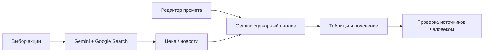

<div align="center">

# Oracle
### Браузерный прототип AI-аналитики акций

**React 19 · TypeScript · Vite · Gemini · Google Search grounding**

[Быстрый старт](#быстрый-старт) · [Демонстрация](docs/DEMO.md) · [Архитектура](docs/ARCHITECTURE.md) · [Безопасность](SECURITY.md)

</div>

## Задача и ценность

Oracle показывает, как объединить поиск рыночной информации, краткий обзор новостей и сценарный AI-анализ в одном рабочем интерфейсе. Пользователь выбирает акцию, запрашивает данные, редактирует инструкции модели и рассматривает результат в виде таблиц сценариев и стресс-тестов.

Для потенциального заказчика проект демонстрирует создание интерфейса для AI-сервиса, интеграцию Gemini с поиском и управление промптами. Репозиторий содержит **учебный браузерный прототип**: Telegram-бот, брокерская интеграция, торговые операции и собственная обученная модель здесь не реализованы. Тексты Project Overview и чек-листа описывают учебные цели, а не выполненные интеграции.

> **Условия демонстрации:** текущая конфигурация встраивает ключ Gemini в браузерную сборку. Используйте приложение локально с отдельным ограниченным ключом; перед публичным размещением нужен серверный слой для API. Подробнее — [SECURITY.md](SECURITY.md).

## Что реализовано

| Экран | Функциональность |
| --- | --- |
| Market Pulse | Запрос цены и изменения цены для META, GOOGL или MSFT через Gemini с Google Search; история запросов в текущей сессии |
| News Intelligence | AI-сводка новостей по трём акциям, категория Positive / Negative / Neutral и ссылки из метаданных поиска, когда доступны |
| Bot Simulator | Получение цены и AI-сценариев Bull / Base / Bear; таблица вероятностей и целевых цен, expected close, confidence, стресс-тесты и пояснение |
| Prompt Editor | Редактирование разделов промпта, сохранение в localStorage и сброс к исходному шаблону |
| Task Checklist | Учебный список задач с переключением статуса и процентом выполнения в текущей сессии |
| Team Roles | Редактируемая таблица демонстрационных участников и обязанностей |
| Report Generator | Генерация текстового абзаца для выбранного раздела учебного отчёта |
| Presentation Helper | Генерация тезисов; интерфейс выводит строки ответа, начинающиеся с дефиса |
| Project Overview | Статическое описание учебного задания и ожидаемых материалов |

Report Generator и Presentation Helper показывают текст в интерфейсе; экспорта DOCX, PDF или PPTX нет. История аналитики, чек-лист и роли не сохраняются после перезагрузки; только промпт хранится в браузере.

## Схема работы



Поиск выполняет модель, а не отдельный прямой клиент Yahoo Finance. Время на карточке — время обработки ответа приложением, не подтверждённая отметка биржевой котировки.

## Стек и устройство

- **React 19**, **TypeScript 5.8**, **Vite 6** — интерфейс и сборка.
- **@google/genai** — запросы к `gemini-3-flash-preview` и `gemini-3-pro-preview`, указанные в исходниках.
- **Google Search grounding** — поиск для цен, новостей и сценариев.
- **Tailwind CSS через CDN** — оформление; **React Context + localStorage** — хранение промпта.
- **npm** — зависимости; lock-файл в исходном репозитории отсутствует.

Доступность указанных preview-моделей и поисковых инструментов зависит от текущего доступа у провайдера. Название Oracle не означает интеграцию с Oracle Database.

## Быстрый старт

Нужны Node.js с npm, интернет и собственный ключ Gemini с доступом к моделям из исходников. Версия Node.js не закреплена в репозитории; сборка и проверка типов при оформлении проверены на Node.js 24.15.0, без ключа и вызовов API.

```bash
git clone https://github.com/tairasset/Oracle-service.git
cd Oracle-service
npm install
```

Скопируйте [`.env.example`](.env.example) в `.env.local` в корне и заполните `GEMINI_API_KEY`. Перезапускайте dev-сервер после изменения ключа.

```bash
npm run dev -- --host 127.0.0.1
```

Откройте `http://localhost:3000` (либо адрес из терминала, если порт занят). Явный host ограничивает доступ локальным компьютером; исходная конфигурация Vite иначе слушает `0.0.0.0`.

Без непустого ключа приложение выбрасывает ошибку при импорте API-сервиса — готового офлайн-режима нет.

Для проверки локальной сборки:

```bash
npm run build
npm run preview -- --host 127.0.0.1
```

Откройте адрес preview из терминала. **Не публикуйте dist с действующим ключом**: переменная окружения не скрывает его от посетителей. Сборка Vite также не заменяет отдельную проверку типов: `npx tsc --noEmit`. Автоматических тестов и lint-скрипта в package.json нет.

## Ограничения аналитики

- Цены и новости извлекаются через ответы LLM с поиском. Задержка, ошибки, неполные данные и неточная привязка ссылок возможны; это не гарантированный поток котировок.
- News-ссылки сопоставляются по индексу grounding chunks с резервным первым URL; соответствие конкретной статье нужно проверить.
- Forecast, confidence и вероятности возвращает модель. Код не проверяет их калибровку, сумму вероятностей или математическую согласованность результата. Бэктестов и метрик доходности в репозитории нет.
- Исходный промпт содержит фиксированный горизонт **2026-01-02** и ограничения, привязанные к этой дате. Перед демонстрацией исправьте связанные даты в Prompt Editor. Автоматическая сборка подставляет текущую UTC-дату лишь в часть шаблона.
- Промпт содержит формулировки про корзину из трёх акций, а симулятор запускается для одной. Подстановка цены также не формирует надёжный набор отдельных цен для трёх компаний; проверьте Inputs Template и согласуйте его с одной выбранной акцией.
- Упоминания финансовых организаций в role-промпте — инструкция модели, а не сведения об авторе, клиентах или партнёрствах.
- Нет серверного API, авторизации, постоянного хранилища и ограничителя запросов приложения. Для публичного продукта нужна отдельная реализация этих частей.
- Результаты предназначены для демонстрации и исследования; финансовой рекомендацией или обещанием доходности они не являются.

## Демонстрация и дальнейшая адаптация

Начните с [сценария демонстрации](docs/DEMO.md). Готовых скриншотов интерфейса в исходном дереве нет; прежний README использовал общий баннер AI Studio. В документации он не выдаётся за изображение продукта.

Возможный следующий этап для заказчика: серверный шлюз Gemini, проверенный источник котировок, строгая проверка ответов, согласованный прогнозный горизонт, оценка качества и постоянное хранилище. Это направления развития, не текущие функции.

- [Архитектура и карта кода](docs/ARCHITECTURE.md)
- [Безопасность](SECURITY.md)
- Второй проект: [Resume Screener — AI-инструмент для HR](https://github.com/tairasset/hr_automation)
- Обсуждение адаптации: [профиль автора](https://github.com/tairasset)

Файл LICENSE отсутствует; условия использования и передачи кода следует согласовать отдельно.
